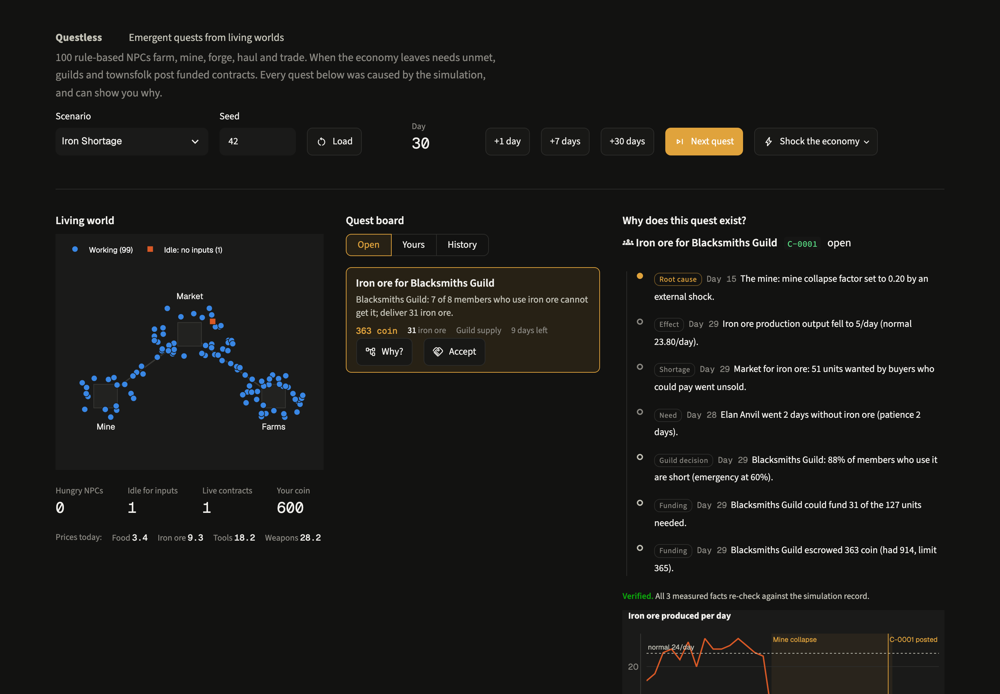
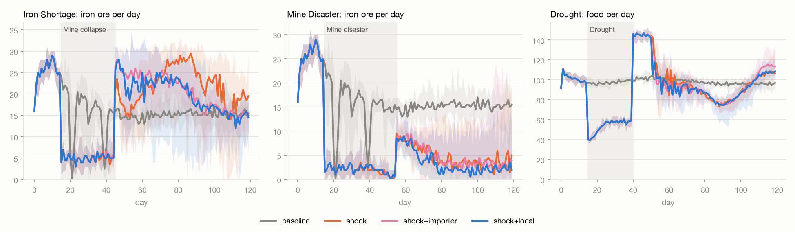

# Questless

**Emergent quests from living worlds, and an open blueprint for the next generation of MMOs.**

Questless is an open-source, deterministic **quest-economy engine for MMO-style worlds**. A settlement
of 100 rule-based NPCs farms, mines, forges, hauls and trades. When the economy leaves needs unmet,
NPCs, guilds and the town post **funded** player contracts. Every contract can answer the question
*"Why does this quest exist?"* with a causal chain built from recorded data, and each number in that
chain can be re-measured to prove it.



## What this is, honestly

Questless has two halves:

| | What it is | Status |
|---|---|---|
| **The engine** | A small, tested Python engine (one settlement, 100 NPCs, 4 goods) with a dashboard, API and CLI. Coin and goods are conserved every simulated day, every quest is funded and explains itself, and every run replays exactly. | **Working today** (v0.1.0, 153 tests) |
| **The blueprint** | A public [roadmap](docs/ROADMAP.md) and [build guide](docs/BUILD_GUIDE.md) for the systems a 2030s megaserver MMO would need: futures and central banks, courts, elections, diplomacy, ecology, fair automation instead of bots, privacy by design, AI steward NPCs, and real-world skills taught through play. | **Planned and open for contributors** (v0.2 to v0.5, about 40 milestones) |

It is **not a game**: there's no 3D client, no combat and no multiplayer server. It's the
groundwork: working proofs of the hard systems at small scale, and a detailed plan for the rest.
Built as a systems-design study by one person with AI-assisted development; MIT licensed.

## Why: a second age of MMOs

The late 1990s and early 2000s were a golden era for massively multiplayer games. *Ultima Online*,
*EverQuest*, *Star Wars Galaxies*, *EVE Online* and *World of Warcraft* gave millions of people
persistent shared worlds with player-driven economies, guilds and politics, and friendships that
lasted years. Economists studied their markets; EVE still runs a single shared world for all its
players.

Since then, very large new MMOs have become rare: they're expensive and risky to build, hard to
balance, and easy to break with bots, inflation and exploits. Many of the problems that sank them
are the ones Questless works on:

| 2000s problem | What the 2030s make possible | Where Questless works on it |
|---|---|---|
| Economies balanced by patch notes, after the damage | Simulate and test balance before release, on every change | Deterministic replay; economy checks on pull requests (M23) |
| Hand-written quests that ignore the world | Quests caused by the world, that explain themselves | The engine today |
| Bots, gold farmers, multiboxing | Fair automation for everyone, economic detection, privacy-respecting identity | M31, M37, [privacy design](docs/PRIVACY_AND_IDENTITY.md) |
| Servers split by size and language | One megaserver with regions and simulation level of detail; live translation | [Blueprint](docs/BLUEPRINT.md), M34, M43 |
| NPCs as vending machines | AI steward NPCs that keep the world fun and push players together | M44 |
| Games as pure escapism | Worlds where players also learn economics, law, politics and data literacy | [Skill tracks](docs/SKILLS.md), M26, M47 |

The settings are interchangeable: the same systems are designed to run a fantasy continent or a
science-fiction galaxy (M33).

## In 30 seconds

A mine collapses on day 15. Ore output falls, smiths run out of ore, and on day 29 the
Blacksmiths Guild posts a contract. This is the engine's own explanation:

```
Day 15: The mine: mine collapse factor set to 0.20 by an external shock.
Day 29: Iron ore production output fell to 5/day (normal 23.80/day).
Day 29: Market for iron ore: 51 units wanted by buyers who could pay went unsold.
Day 28: Elan Anvil went 2 days without iron ore (patience 2 days).
Day 29: Blacksmiths Guild: 88% of members who use it are short (emergency at 60%).
Day 29: Blacksmiths Guild could fund 31 of the 127 units needed.
Day 29: Blacksmiths Guild escrowed 363 coin (had 914, limit 365).
```

Nothing in that chain is written by hand. In a longer disaster the walk goes further:

**Mine disaster → ore output down → smiths idle → tools output down → farmers without tools → food output down → a food contract.**

That food contract is linked to the earlier ore contract as its parent.

## Quickstart

Requires [uv](https://docs.astral.sh/uv/), which installs the pinned Python (3.12) for you.

```bash
git clone https://github.com/Adiezc/questless.git && cd questless
uv sync --extra demo
uv run questless demo
```

That opens the dashboard at http://localhost:8501. It starts on a live quest; press **Why?**,
**Accept**, send a caravan, advance 3 days and **Deliver**.

Headless:

```bash
uv run questless run scenarios/iron_shortage.toml           # contracts and why they exist
uv run questless run scenarios/drought.toml --json          # machine-readable
uv run questless run scenarios/bandits.toml --save s.json   # save the run
uv run questless replay s.json                              # rebuild it and verify the state hash
uv run pytest                                               # 153 tests, ~14 s
```

## How it works

```
 NPC activity ──► economic conditions ──► unmet needs ──► funded contracts
      ▲                                                          │
      └──────────── world consequences ◄──── player actions ◄────┘
```

- **NPCs** (34 farmers, 16 miners, 8 blacksmiths, 14 merchants, 28 guards) follow priority rules:
  eat, keep their tools working, produce, trade. There's no LLM and no scripting; behaviour is
  seeded and deterministic.
- **Market and transport:** goods are traded once a day at prices that follow production,
  consumption and stock cover. Merchants haul goods from the mine and farms to the market, with
  limited daily capacity.
- **Guilds** (Miners, Merchants, Blacksmiths) collect dues, keep members able to work, and pool
  members' needs into one contract when many share them. The town does the same for its guards.
- **Contracts** are posted only for persistent **scarcity**: the NPC needed the good, could pay
  for it, and nobody could sell. Poverty is tracked separately. Before posting, a contract must be:
  - **funded:** the reward is escrowed by the NPC, its guild or the town. A guild that can't
    afford the whole job posts what it can.
  - **deduplicated:** one live contract per need.
  - **cooled down:** a need whose contract expired or was withdrawn waits before it can post again.
  - **capped:** limits on live contracts and on new contracts per day.
  - **feasible:** someone could actually obtain the goods.
- **Provenance:** a bounded causal walk explains each shortage back to its root cause, using
  production drops against a pre-shock baseline, equipment and input shortages among producers,
  price spikes and shocks. Measured facts carry their metric key, so `verify()` can recompute them.
- **Players** source goods honestly: they buy from NPCs (which moves prices) or import by caravan
  (finite stock, takes 3 days).

Details: [Architecture](docs/ARCHITECTURE.md) · [Simulation spec](docs/SIMULATION_SPEC.md) ·
[Demo guide](docs/DEMO.md) · [Original plan](docs/PLAN.md)

## Design guarantees (all tested)

- **Conservation:** coin and goods are conserved on every simulated day. All changes go through
  one ledger, and no balance ever goes negative.
- **Every contract is funded:** escrow always equals the rewards of live contracts.
- **Every contract explains itself, verifiably:** the counterfactual test (same seed, no shock)
  produces no such contract, and forged evidence is detected.
- **Bounded:** there's at most one live contract per need, plus cooldowns, a global cap and a
  per-day cap. These hold under three simultaneous extreme shocks and against a random "chaos
  player".
- **Deterministic:** the same scenario, seed and player actions give the same SHA-256 state hash,
  across processes and Python hash seeds. Save files replay exactly.

## Results

Ran 180 paired runs (3 scenarios × 6 setups × 10 seeds). Each shocked run is measured against
the no-shock run on the same seed. Full write-up: [docs/RESULTS.md](docs/RESULTS.md).



| Finding | Number |
|---|---|
| Invalid contracts across all runs | **0 of 180 runs** |
| Iron shortage: days with >10% demand unmet, no player vs scripted player | **39 → 19-20** |
| Iron shortage: recovery after the mine reopens, no player vs player | 4 → 2 days |
| Mine disaster: seeds that recover (any arm) | 0-2 of 10: an economic trap contracts can't fix |
| Hungry NPC-days with guilds on vs off (iron / disaster / drought) | 3 vs 172 · 740 vs 1416 · 463 vs 577 |
| Speed | ~1.9 ms per simulated day for 100 NPCs (M4 MacBook Air), invariants checked every day |

Quests also have side effects, which the engine makes visible. Player profit leaves circulation,
and importing finished goods takes sales from local producers.

## Use it from Python

```python
from questless import Simulation

sim = Simulation.from_scenario("scenarios/iron_shortage.toml")
cid = sim.run_until_contract()           # day 30: the Blacksmiths Guild posts C-0001
print("\n".join(sim.explain(cid)))       # the causal chain above
assert sim.verify(cid) == []             # every measured fact re-checks

c = sim.contract(cid)
sim.accept(cid)
arrives = sim.caravan("iron_ore", c.qty) # import the ore; costs coin, takes 3 days
sim.step(arrives - sim.day)
sim.deliver(cid)                         # goods to the smiths, escrowed reward to you
sim.save("run.json")                     # tiny: scenario + action log + state hash
```

Scenarios are TOML and can extend each other ([`scenarios/`](scenarios/)). Every rate, threshold
and premium is a designer knob, with no code changes. `uv run python experiments/calibrate.py`
reports each scenario against its targets across 10 seeds.

## Scope and limitations

**What it is:** one settlement, 100 NPCs, 4 goods, rule-based agents, a Streamlit dashboard and a
Python API.

**What it is not:** a game client, multiplayer, an LLM agent system, or production-ready engine
integration.

**What's next:** the [roadmap](docs/ROADMAP.md) runs from v0.2 to v0.5:
- **v0.2:** relief and loan quests, futures, smuggling, a central bank, run reports, a clearer
  dashboard.
- **v0.3:** economy checks on every pull request, an AI-agent training environment, a self-writing
  world wiki with developer-only private pages, lessons drawn from each run, bug reports that
  replay themselves, courts, a tamper-evident log, anti-multiboxing safeguards, elections and a
  campaign-finance register.
- **v0.4, megaserver foundations:** fantasy and sci-fi themes, regions with simulation level of
  detail, a map and ecology shaped by the economy, standing orders instead of bots,
  player-posted quests, treaties and embargoes.
- **v0.5, people, privacy and learning:** privacy as code, a language bridge with English as the
  common language, steward NPCs, a skills passport and eleven skill tracks.

Background reading: [blueprint](docs/BLUEPRINT.md) ·
[crypto and blockchain assessment](docs/BLOCKCHAIN.md) (why there are no tokens or NFTs) ·
[privacy and identity](docs/PRIVACY_AND_IDENTITY.md) · [real-world skills](docs/SKILLS.md).

**Known limitations:**
- Producers in the same trade pause in sync when unsold stock builds up.
- Feedback loops (ore, then tools, then ore) appear in a chain but aren't drawn as loops.
- Reputation only nudges rewards.
- See [docs/RESULTS.md](docs/RESULTS.md#limitations) for the experiment's caveats.

## Prior art

Quests from NPC needs and NPC-driven economies both exist already. Questless combines them, with
contracts that must be funded, validated and explained from data.

- **Economies:** J. Doran & I. Parberry, *Emergent Economies for Role Playing Games*. L. Doucet,
  *BazaarBot*.
- **Quests from NPC goals:** Breault et al., *Let CONAN tell you a story: Procedural quest
  generation* (2018). *Procedural Quest Generation by NPC in MMORPG*, Journal of Korea Game Society.
- **Background:** Doran & Parberry, structure of 750+ MMORPG quests (PCG 2011). Kybartas &
  Bidarra, story-generation survey (IEEE TCIAIG 2017). J. Ryan, *Curating Simulated Storyworlds*.

Links and notes are in [docs/EVALUATION.md](docs/EVALUATION.md#6-comparable-work-verified-sources).

## Contribute

Most of the roadmap is unbuilt, and it's designed to be built in the open.
- **Start here:** [CONTRIBUTING.md](CONTRIBUTING.md) explains what gets merged, the checks every
  pull request must pass (tests, lint, security scans), and how contributors are credited.
- **Pick a task:** [docs/BUILD_GUIDE.md](docs/BUILD_GUIDE.md) breaks every milestone into
  issue-sized tasks with the files to touch, tests to write and pitfalls; look for
  **good first issue**.
- **Not a programmer?** Economists, lawyers, teachers and political scientists can write lessons
  and skill tracks without touching the engine.
- **Have an idea?** Suggest it in [Discussions](https://github.com/Adiezc/questless/discussions/categories/ideas)
  or with the **Suggest an idea** issue template.
- **Security issues:** report privately, see [SECURITY.md](SECURITY.md).

## Creator

Created by **Adrian Diez Cuadrado**. The fastest way to get in touch is
[LinkedIn](https://www.linkedin.com/in/adriandiez10/). To cite this work, see
[CITATION.cff](CITATION.cff).

Built with AI-assisted development (Claude); design decisions and responsibility rest with the
creator.

## Licence

[MIT](LICENSE) © 2026 Adrian Diez Cuadrado. You may use, modify and distribute Questless, including
commercially, provided the copyright and permission notice is kept in copies or substantial portions
of the software. A credit or a short note if you use it is appreciated, but not required.
