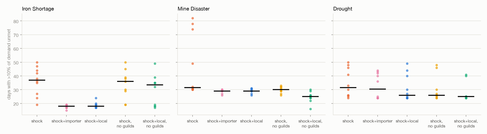

# Results: what player contracts and guilds do to a shocked economy

Reproduce with:

```bash
uv run --extra experiments python experiments/shock_vs_baseline.py --seeds 10
```

That takes about 45 seconds. Last regenerated on 2026-10-23, after the town reserve (#72), the pool fix (#46) and the daily purchase cap (#93). The generated tables are in [`experiments/results/summary.md`](../experiments/results/summary.md), with raw rows in [`runs.csv`](../experiments/results/runs.csv).

## Setup

- **Scope:** 3 scenarios × 6 arms × 10 seeds × 120 days = 180 runs. All arms share seeds, so each comparison is paired.
- **Measurement window:** every measure runs from the shock's first day.
- **Counterfactual:** "output" and "recovery" are measured against the **no-shock run on the same seed**. The baseline economy drifts on its own, so comparing with the first few days would mislead.
- **The player is scripted:** a greedy but honest bot using only the public API. It holds up to 3 contracts, takes the best rewards, and delivers as soon as it holds the goods.
  - **importer:** brings in any good by caravan from the next town.
  - **local:** buys from the market first, and imports only raw goods (food, ore), never what local smiths make.




## Findings (medians across 10 seeds, ranges in the generated tables)

**1. Contracts are always valid.** Across all 180 runs, every posted contract re-verifies against the simulation record: 0 invalid contracts. That includes runs where a bot plays aggressively.

**2. In a recoverable shock, fulfilling contracts halves the shortage.**

| Iron shortage | Shortage days | Recovery after mine reopens |
|---|---|---|
| no player | 37 | 3 days |
| importer | 18 | 2 days |
| local | 18 | 2 days |

**3. Player contracts do not break an economic trap.** In the mine disaster, ore output stays at about 20% of the no-shock run whether or not the player helps. At most 2 of 10 seeds recover (2 with no player, none with one). Broke miners can't buy tools, and contracts move goods but don't restore their purchasing power. Getting out of a liquidity trap needs a different instrument, such as loans, subsidies or a relief program. That's a design finding, not a tuning problem.

**4. Guilds are the safety net.** Disabling guilds raises hunger in every scenario:

| Hungry NPC-days | Iron shortage | Mine disaster | Drought |
|---|---|---|---|
| guilds on | 6 | 843 | 466 |
| guilds off | 176 | 1423 | 573 |

**5. Quests have side effects, and the engine shows them.** With an active player, hunger rose in the iron shortage (6 → 117-118 NPC-days). Two mechanisms, both visible in the data:
- **Profit leaves circulation.** The bot earns 324-500 coin per run in the iron shortage (median) and never spends it in town. Every coin it keeps is a coin the town no longer has.
- **Imports crowd out local producers.** An earlier version of this experiment, before traders could also buy the town's surplus, showed this most starkly. A bot importing finished tools left miners with 37 coin between them, against 1,103 without the bot. Imported tools replaced local smiths' sales, so smiths bought less ore. The current engine routes caravan coin back into the town as purchases of its surplus, which softens the effect but doesn't remove it.

**6. The drought shows no player effect beyond noise** on shortage days: 32 (no player) vs 26-30 (with player), with heavily overlapping ranges. Food contracts are small and many, and the market recovers 2 days after the rain returns, so there's little left for a player to fix.

## What this means for a design

- **A player contract shortens a scarcity crisis.** That's the intended loop, and it holds up.
- **A player contract does not fix a poverty trap.** If you want quests to rescue a stricken economy, the quest has to inject purchasing power (wages, loans), not only goods.
- **Where quest goods come from matters.** Importing finished goods competes with the local supply chain; sourcing locally or importing inputs supports it. A designer can steer this with the caravan markup or by limiting which goods can be imported.
- **Player wealth is a coin sink.** A live game would want the player to spend in town, or a fee on rewards.

## See also

- **Exploit hunt (M52):** scripted attackers against honest play on the same scenarios, in [`experiments/results/exploit_hunt.md`](../experiments/results/exploit_hunt.md). No exploit since #93, which hid the shock schedule from players and capped how much of a good they can buy in a day; before that, buying ore ahead of the Iron Shortage won on most seeds and added hunger.
- **Late joiners (M58.2):** a newcomer to a 1,000-day-old world, in [`experiments/results/late_joiners.md`](../experiments/results/late_joiners.md).

## Limitations

- **One bot policy family.** No human players and no learning agents.
- **Synchronised production pauses.** In the no-shock baseline, miners hit their unsold-stock cap together and pause together. That shows up as dips in the grey baseline line. A real fix is per-NPC randomised selling thresholds.
- **Shocks can lower hunger.** In the no-shock baseline, hunger from day 15 is higher (110) than in the iron shortage (6). The shock raises ore prices and with them miners' incomes. Shocks are not uniformly bad for everyone, which is plausible but not studied further.
- **Fixed horizon and scale.** One settlement, 100 NPCs, 120 days.
